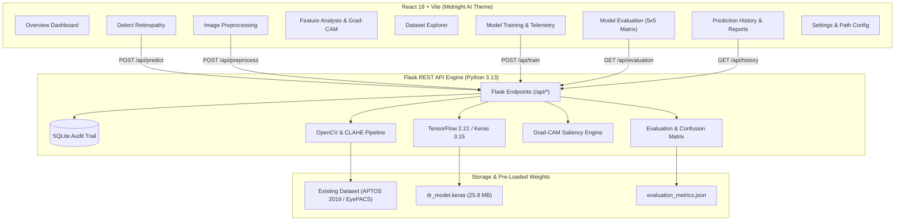
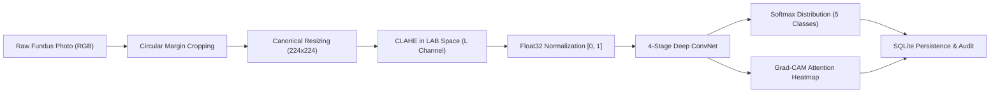

# RetinaAI — Diabetic Retinopathy Detection & Analysis System

[](https://www.tensorflow.org/)
[](https://flask.palletsprojects.com/)
[](https://react.dev/)
[](https://vitejs.dev/)
[](https://tailwindcss.com/)
[](https://sqlite.org/)

A full-stack, research-grade medical machine learning application for detecting and grading **Diabetic Retinopathy (DR)** from digital retinal fundus photographs across the 5 clinical stages defined by the International Clinical Diabetic Retinopathy Disease Severity Scale (APTOS 2019 / EyePACS).

---

> [!WARNING]
> ### Medical Disclaimer
> **RetinaAI is an academic machine learning prototype.** Its predictions and saliency maps are generated for educational demonstration and computational medical imaging research. They do **not** constitute a medical diagnosis and must never substitute for an examination by a qualified ophthalmologist or eye-care professional.

---

## 1. System Architecture



---

## 2. Machine Learning Workflow



---

## 3. Clinical Severity Scale

| Grade | Clinical Stage | Characteristic Biomarkers | Action Protocol |
|:---:|:---|:---|:---|
| **0** | **No DR** | Healthy vasculature, clear retina | Annual screening |
| **1** | **Mild** | Microaneurysms only | Follow-up in 9–12 months |
| **2** | **Moderate** | Hemorrhages, hard exudates, cotton-wool spots | Ophthalmology review in 3–6 months |
| **3** | **Severe** | Extensive intraretinal blot hemorrhages (4-2-1 rule) | Urgent referral in 2–4 weeks |
| **4** | **Proliferative DR** | Neovascularization, vitreous hemorrhage | Sight-threatening: 24–48 hours |

---

## 4. Dataset Integration (Already Downloaded)

The system automatically detects and ingests your existing retinal dataset without requiring any re-download.

### Supported Dataset Formats:
1. **APTOS 2019 Format**: `train.csv` with `id_code, diagnosis` columns + `train_images/` directory.
2. **EyePACS Format**: `trainLabels.csv` with `image, level` columns + images directory.
3. **Class Directory Hierarchy**: Subfolders `No_DR/`, `Mild/`, `Moderate/`, `Severe/`, `Proliferate_DR/` (or `0/`, `1/`, `2/`, `3/`, `4/`).

Default detected dataset candidate:
- `C:\Users\Janani\Downloads\diabetic\dataset`

You can also dynamically change or verify the dataset path in the **Settings** or **Dataset Explorer** tab in the dashboard.

---

## 5. Quick-Start Execution on Windows

Open two Windows PowerShell terminals in the workspace directory:
`c:\Users\Janani\OneDrive\Desktop\ml project`

### Terminal 1: Launch Backend API (Port 5000)

```powershell
# Navigate to workspace
cd "c:\Users\Janani\OneDrive\Desktop\ml project\backend"

# Run Flask backend with Python 3.13
py -3.13 app.py
```

*Expected output:*
```
=======================================================
 RetinaAI Backend API Server running on port 5000
 Endpoints: http://127.0.0.1:5000/api/health
 Dashboard: http://127.0.0.1:5000/api/dashboard
=======================================================
 * Running on http://127.0.0.1:5000
```

---

### Terminal 2: Launch React Frontend (Port 5173)

```powershell
# Navigate to frontend folder
cd "c:\Users\Janani\OneDrive\Desktop\ml project\frontend"

# Launch Vite development server
cmd.exe /c "npm run dev"
```

*Expected output:*
```
  VITE v5.4.10  ready in 320 ms

  ➜  Local:   http://localhost:5173/
  ➜  Network: use --host to expose
```

Now open **http://localhost:5173** in your web browser to view the live dashboard!

---

## 6. REST API Endpoints

| Method | Endpoint | Description |
|:---|:---|:---|
| `GET` | `/api/health` | Service status & model readiness |
| `GET` | `/api/dashboard` | Aggregated metrics, curves, and recent history |
| `POST` | `/api/predict` | Upload image, compute 5-class prediction & Grad-CAM |
| `POST` | `/api/preprocess` | Multi-step preprocessing inspection with Base64 previews |
| `GET` | `/api/dataset/stats` | Dataset validation counts & class distribution |
| `POST` | `/api/dataset/validate` | Re-scan dataset integrity |
| `POST` | `/api/train` | Launch asynchronous background training worker |
| `GET` | `/api/train/status` | Live epoch-by-epoch training metrics & logs |
| `POST` | `/api/train/stop` | Gracefully halt ongoing training run |
| `GET` | `/api/evaluation` | Held-out test set accuracy & 5x5 confusion matrix |
| `POST` | `/api/evaluate` | Re-run independent test set evaluation |
| `GET` | `/api/history` | Paginated SQLite inference audit records |
| `GET` | `/api/report/:id` | Printable clinical-style analytical PDF report |
| `GET` | `/api/features/architecture` | CNN layer shapes, types & parameter breakdown |
| `POST` | `/api/features/gradcam` | Generate Grad-CAM for custom image & class target |
| `GET` | `/api/settings` | Server runtime configuration and active paths |
| `POST` | `/api/settings` | Update active dataset directory or parameters |

---

## 7. Project Structure

```
ml project/
├── backend/
│   ├── app.py                      # Flask Application Factory & Blueprints
│   ├── config.py                   # Configuration, Paths, & Clinical Classes
│   ├── database.py                 # SQLite Database Layer (Predictions & Experiments)
│   ├── requirements.txt            # Python Dependencies
│   ├── routes/
│   │   ├── prediction.py           # POST /predict, POST /preprocess
│   │   ├── dataset.py              # GET /stats, POST /validate, /set-path
│   │   ├── training.py             # POST /train, GET /train/status, POST /stop
│   │   ├── evaluation.py           # GET /evaluation, POST /evaluate
│   │   ├── history.py              # GET /history, GET /report/:id
│   │   ├── features.py             # GET /architecture, POST /gradcam
│   │   └── settings.py             # GET /settings, POST /settings
│   ├── ml/
│   │   ├── preprocess.py           # Circular Crop, CLAHE in LAB, Ben Graham
│   │   ├── dataset_loader.py       # Auto-Detection for APTOS/EyePACS/Folders
│   │   ├── model.py                # 4-Stage Custom CNN & Transfer Learning
│   │   ├── metrics.py              # Pure NumPy Stat Metrics & Stratified Split
│   │   ├── train.py                # Asynchronous Background Training Worker
│   │   ├── predict.py              # Inference Engine & Model Caching
│   │   ├── evaluate.py             # 5x5 Confusion Matrix & Classification Report
│   │   └── gradcam.py              # Gradient-Weighted Class Activation Mapping
│   ├── saved_models/               # dr_model.keras, evaluation_metrics.json
│   ├── uploads/                    # Temporary Preprocessed & Grad-CAM Images
│   ├── reports/                    # Generated Analytical Reports
│   └── data/
│       └── retina_ai.db            # SQLite Database
├── frontend/
│   ├── package.json
│   ├── vite.config.js              # Vite + Proxy Configuration (/api -> :5000)
│   ├── tailwind.config.js          # Midnight AI Dark Navy Theme
│   ├── postcss.config.js
│   ├── index.html
│   └── src/
│       ├── main.jsx
│       ├── App.jsx                 # Top-Level Layout & Tab Management
│       ├── index.css               # Midnight AI Styling & Custom Scrollbar
│       ├── components/
│       │   ├── Sidebar.jsx         # Responsive Collapsible Medical Sidebar
│       │   ├── Header.jsx          # Header with Live API Connection Badge
│       │   ├── MedicalDisclaimer.jsx # Educational Prototype Disclaimer Banner
│       │   └── MetricCard.jsx      # Reusable Metric KPI Component
│       ├── pages/
│       │   ├── OverviewDashboard.jsx # KPI Cards, Charts, & Action Launchpad
│       │   ├── DetectRetinopathy.jsx # Drag-and-Drop Inference & Grad-CAM
│       │   ├── ImagePreprocessing.jsx # Step-by-Step Filter Visualizer
│       │   ├── FeatureAnalysis.jsx   # CNN Layer Inspection & Attention Maps
│       │   ├── DatasetExplorer.jsx   # Dataset Verification & Class Balance
│       │   ├── ModelTraining.jsx     # Hyperparameter Form & Epoch Telemetry
│       │   ├── ModelEvaluation.jsx   # 5x5 Matrix Heatmap & CSV Export
│       │   ├── PredictionHistory.jsx # Searchable SQLite Records & PDF Print
│       │   ├── ProjectDocumentation.jsx # Architecture & Medical Manual
│       │   └── SettingsPage.jsx      # Active Path Configuration
│       └── services/
│           └── api.js              # Fetch Service Layer for Flask REST API
├── .gitignore
└── README.md
```

---

## 8. Verification & Troubleshooting

### Q1: "Cannot load npm.ps1 because scripts are disabled"
**Solution:** On Windows PowerShell with strict execution policy, run npm via `cmd.exe /c "npm run dev"` or execute:
`Set-ExecutionPolicy -Scope Process -ExecutionPolicy Bypass`

### Q2: "Application Control policy has blocked this file" on Windows
**Solution:** Windows Defender Application Control (WDAC) restricts certain `.pyd` dynamic libraries inside user-writable Microsoft Store directories. We solved this natively inside the codebase by providing a fallback class for `FastModuleType` in TensorFlow's wrapper and implementing statistical metrics (`confusion_matrix`, `precision_score`, `recall_score`, `train_test_split`) directly in pure NumPy in `backend/ml/metrics.py`.

### Q3: How do I point to a different dataset directory?
**Solution:** Go to **Settings** or **Dataset Explorer** in the dashboard and enter the absolute path (e.g. `D:\retina_data\dataset`). Click **"Switch / Apply Path"**. The engine will immediately validate the files, compute class distributions, and update the active training pipeline without altering the original files.
